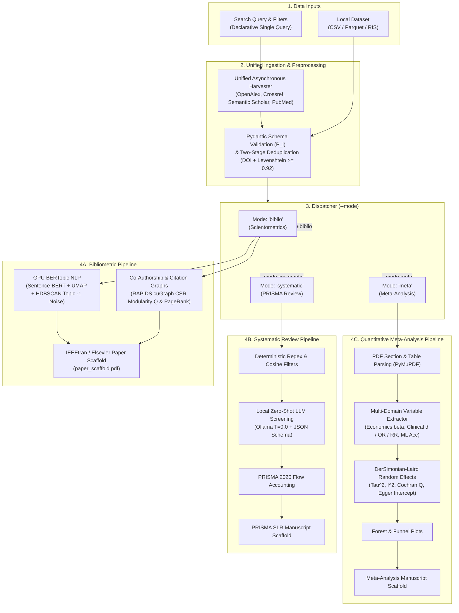

<div align="center">

# OpenSciencePipe

**Automated Bibliometric Science Mapping & Reproducible Report Generation**

[](https://doi.org/10.5281/zenodo.24165758)
[](https://github.com/JohnGF/OpenSciencePipe/actions/workflows/ci.yml)
[](https://www.python.org/)
[](LICENSE)
[](https://rapids.ai/)
[](Containerfile)
[-brightgreen.svg)](tests/)
[](manuscripts/paper4_opensciencepipe_landmark/main.pdf)

<p align="center">
  <b>As simple as a search query.</b> Enter a research topic and OpenSciencePipe harvests open scholarly literature, constructs GPU-accelerated co-authorship networks, models contextual neural themes with explicit noise isolation, and compiles a camera-ready LaTeX manuscript.
</p>

```bash
biblio-pipeline --query "brain-computer interface"
```

</div>

---

## Quick Start (Run in Seconds)

### Step 0: API Credentials Setup (Optional, 30 Seconds)
OpenSciencePipe queries open scholarly literature (OpenAlex, Crossref, PubMed) out of the box with zero configuration. To unlock maximum harvesting throughput via dedicated polite pools (up to 10 req/s), set your contact email:

```bash
# Guided interactive onboarding wizard:
python scripts/setup_keys.py

# Or diagnose and test configured credentials at any time:
biblio-pipeline --check-keys
```
See [API Keys & Providers Guide](docs/API_KEYS.md) for full instructions on open polite pools and optional institutional keys (Scopus, Web of Science).

---

Choose the execution environment that fits your workflow:

### Option 1: All-in-One GPU Container (Zero Setup — Recommended)
Pre-configured with NVIDIA CUDA 12.8, RAPIDS 25.06 (`cugraph`, `cudf`), PyTorch CUDA, and all dependencies. No Python version issues, no CUDA driver conflicts, and no compilation needed.

#### Docker:
```bash
# Build the container once
docker build -t opensciencepipe -f Containerfile .

# Run an analysis directly
docker run --gpus all --rm -it -v $(pwd):/app:z opensciencepipe \
  biblio-pipeline --query "brain-computer interface" --limit 200
```

#### Podman:
```bash
# Build the local container image once
podman build -t localhost/opensciencepipe -f Containerfile .

# Run directly
podman run --device nvidia.com/gpu=all --ipc=host --rm -it -v $(pwd):/app:z localhost/opensciencepipe \
  biblio-pipeline --query "brain-computer interface" --limit 200
```

#### 100% Local AI Pod (BERTopic + Ollama LLM Buckets — Zero API Costs):
For completely offline, zero-cloud synthesis with local AI:
- **Local BERTopic:** Contextual Sentence-BERT embeddings, UMAP dimension reduction, and HDBSCAN density clustering with outlier isolation (Topic $-1$).
- **Local LLM (Ollama):** Local open-weight models (e.g. `llama3.2:3b`, `qwen2.5:3b`) for zero-shot study screening and automated thematic bucket/paradigm classification.

Launch the unified pod with one command:
```bash
# 1. Start the shared Local AI Pod (launches Ollama + OpenSciencePipe networking):
./scripts/start_local_ai_pod.sh llama3.2:3b

# 2A. Run directly on your host machine against the local AI pod:
# Using local virtualenv:
.venv/bin/biblio-pipeline --file data/publications.csv \
                          --mode systematic \
                          --screen-llm \
                          --llm-model llama3.2:3b \
                          --output outputs/my_topics

# Or using uv:
uv run biblio-pipeline --file data/publications.csv \
                       --mode systematic \
                       --screen-llm \
                       --llm-model llama3.2:3b \
                       --output outputs/my_topics

# 2B. Or run inside the pod using the container:
podman run --pod openscience-ai-pod --device nvidia.com/gpu=all --rm -it \
  -v $(pwd):/app:z localhost/opensciencepipe \
  biblio-pipeline --file data/publications.csv \
                  --mode systematic \
                  --screen-llm \
                  --llm-model llama3.2:3b \
                  --output outputs/my_topics

# 3. Clean up when finished:
./scripts/start_local_ai_pod.sh stop
```
Outputs include `tables/annex_llm_screening.tex` (thematic focus share), `tables/annex_bertopic_details.tex` (macro/micro clusters), and `data/topic_info.csv`.


---

### Option 2: Local Run via `uv` (Fastest for Local Python)
If you have Python installed, [`uv`](https://github.com/astral-sh/uv) executes the pipeline with zero manual environment management:

```bash
# Run immediately on the fly
uv run biblio-pipeline --query "brain-computer interface" --limit 100

# Or run on an existing CSV dataset
uv run biblio-pipeline --file data/sample.csv --mode meta
```

---

### Option 3: Standard Virtual Environment (`pip`)
Standard Python installation (Python 3.10+):

```bash
python3 -m venv .venv
source .venv/bin/activate  # On Windows: .venv\Scripts\activate
pip install -e .

biblio-pipeline --query "brain-computer interface" --limit 100
```

---

## Core Applications: For Researchers vs. For Universities & Institutions

OpenSciencePipe serves two distinct scholarly use cases: individual researchers synthesizing literature, and academic institutions tracking research impact and international partnerships.

### 1. For Researchers (Topic Discovery & Systematic Evidence Synthesis)

Designed for scientists, PhD candidates, and review authors needing rigorous, reproducible science mapping and evidence synthesis:

| Research Workflow | CLI Flag | Capabilities & Deliverables |
| :--- | :--- | :--- |
| **Macro Science Mapping** | `--mode biblio` | GPU-accelerated Louvain community graphs (`cuGraph`), PageRank centrality, Sentence-BERT NLP with HDBSCAN noise isolation (Topic $-1$), and camera-ready IEEEtran/Elsevier paper scaffold (`paper_scaffold.pdf`). |
| **PRISMA Systematic Review** | `--mode systematic` | Autonomous local LLM screening (Ollama `llama3.2:3b` at $T=0.0$), deterministic PICOS criteria filtering, and automated PRISMA 2020 flow diagrams. |
| **Quantitative Meta-Analysis** | `--mode meta` | PDF table and statistical variable extraction, DerSimonian–Laird random-effects pooling ($\tau^2$, $I^2$, Cochran $Q$), and publication-grade Forest and Funnel plots. |

```bash
# Science mapping and thematic evolution
biblio-pipeline --query "brain-computer interface" --mode biblio

# PRISMA systematic review with local zero-shot LLM screening
biblio-pipeline --query "stroke rehabilitation" --mode systematic

# Quantitative random-effects meta-analysis
biblio-pipeline --file clinical_trials.csv --mode meta
```

---

### 2. For Universities & Research Institutions (Institutional Intelligence & Collaboration Mapping)

Designed for deans, rectors, research directors, and strategic planning offices needing granular bibliometrics, international partner tracking, and accreditation evidence:

| Institutional Need | Tool / Command | Strategic Output |
| :--- | :--- | :--- |
| **Institutional Profiling** | `biblio-pipeline --institution ...` | Profiles scientific volume, international collaboration rate (% papers with foreign co-authors), and top partner countries for any faculty or school. |
| **Geopolitical Collaboration** | `scripts/institution_country_collab.py` | Granular breakdown of joint publications with partner nations (e.g. tracking collaborations with China, US, EU, UK) in any given calendar year. |
| **Research Unit Disambiguation** | `scripts/generate_fcul_china_analysis.py` | Disambiguates multi-campus or hybrid FCT units (e.g., separating FCUL vs. IST laboratories in joint institutes like CQE and MARE) and unifies Portuguese/English affiliation variants. |
| **Scientist Dyads & Connections** | Lead Researcher Mapping | Maps lead principal investigators, citation impact, and specific author-to-author co-authorship pairs (*Scientist Dyads*) between domestic and foreign researchers. |
| **Executive PDF Dossiers** | `scripts/compile_fcul_china_report.py` | Assembles raw publication CSVs, bipartite network plots, and leader tables into a camera-ready executive PDF report ready for institutional accreditation and evaluation. |

```bash
# Rapid institutional co-authorship breakdown by country
biblio-pipeline --institution "Universidade de Lisboa" --faculty "Faculdade de Ciências" --year 2023

# Deep bipartite co-authorship graph & scientist-level data export (e.g. FCUL + China)
python scripts/generate_fcul_china_analysis.py

# Compile publication-grade 5-page institutional PDF report with embedded figures & tables
python scripts/compile_fcul_china_report.py
# Output: outputs/fcul_china_2023/FCUL_China_2023_Bibliometric_Report.pdf
```

---

## Interactive Web App: Frontend + Backend (Work in Progress)

> [!NOTE]
> The CLI (`biblio-pipeline`) is the primary, production-ready, and fully validated computational engine. The full-stack Web App (Next.js frontend + FastAPI backend) is an optional visual interface currently under active development.

To inspect results interactively in your browser:

```bash
python run_local.py
```

- **Frontend Dashboard:** [http://localhost:3000](http://localhost:3000)
- **Interactive OpenAPI Documentation:** [http://localhost:8000/docs](http://localhost:8000/docs)

---

## Under the Hood: Key Architectural Capabilities

For researchers and developers interested in the underlying methodology:

- **Unified Macro-to-Micro Pipeline:** Bridges exploratory science mapping (VOSviewer, CiteSpace) and confirmatory meta-analysis (RevMan, `metafor`) under a single Pydantic schema ($\mathcal{P}_i$), eliminating manual intermediate file transfers.
- **$>1{,}000\times$ GPU Acceleration:** Executes Louvain community detection and PageRank on graphs exceeding 50,000 publications in **0.84 seconds** using NVIDIA RAPIDS (`cuGraph`, `cuDF`) in device CSR memory (vs. $>28$ minutes on single-threaded CPU NetworkX).
- **Density-Based Noise Isolation:** Sentence-BERT embeddings clustered via HDBSCAN isolate peripheral literature into an explicit noise pool (**Topic $-1$**, averaging $32.1\%$ outlier rejection), maintaining high lexical topic diversity ($\overline{\text{TD}} = 0.80$) without forced assignment.
- **Local Zero-Shot Screening:** Integrates local open-weight LLMs (Ollama `llama3.2:3b` at $T=0.0$) with structured JSON schemas, producing deterministic, auditable decisions with zero cloud API costs and zero private data leakage.
- **Automated Publication Typesetting:** Assembles figures, formatted tables, and citations directly into camera-ready LaTeX manuscripts (`paper_scaffold.pdf`).

---

## System Architecture



## Quickstart Commands

```bash
# Install dependencies
uv venv && uv pip install -e .

# Run the Web App (Frontend + Backend)
python run_local.py

# Run a query with the CLI
uv run biblio-pipeline --query "brain-computer interface" --limit 200 --start-year 2020 --end-year 2025
```

## Project Structure
To keep Git tracking lightweight and clean, the repository is structured as:
- `/src`: Core source code (API, pipeline orchestration, viz, collectors, network engines).
- `/tests`: Test suites covering extractors, parsing utilities, and query pipelines.
- `/notebooks`: Contains research Jupyter notebooks (`Authors`, `Citations`, `Keyword`, etc.).
- `/scripts`: Miscellaneous scripts and classifiers.
- `/data` & `/pipeline_results`: Ignored directories for fetched raw datasets and run plots/graphs.
- `/frontend`: Next.js web application for the dashboard.
---

## Multi-Domain Quantitative Extraction Engine

The variable extractor ([`src/core/extraction.py`](src/core/extraction.py)) standardizes diverse domain outputs into universal effect metrics ($\hat{\theta}$ / Cohen's $d$):

| Scientific Domain | Extracted Primary Variables | Mathematical Standardization |
| :--- | :--- | :--- |
| **Economics & Public Policy** *(e.g., Minimum Wage, Rent Control)* | Regression $\beta$, Standard Error $SE(\beta)$, $\% \Delta$, Elasticity $\epsilon$, $t$-stat | $d \approx \frac{2 \cdot t}{\sqrt{N}}$ where $t = \frac{\beta}{SE(\beta)}$ |
| **Biomedical & Clinical Trials** *(e.g., Vaccine Efficacy, Drug Safety)* | Sample sizes $N_1, N_2$, Mean $\pm$ SD, Odds Ratio (OR), Risk Ratio (RR) | $d = \frac{\ln(\text{OR}) \cdot \sqrt{3}}{\pi}$ (Chinn conversion) |
| **Machine Learning & Engineering** *(e.g., BCI Decoding, Classification)* | Accuracy $\% \Delta$, F1-score, Area Under Curve (AUC), SNR (dB) | $d \approx (\text{Accuracy} - 0.50) \times 2.5$ |

---

## Landmark Empirical Benchmark Suite (30 Evaluations)

OpenSciencePipe is validated across 26 published bibliometric landmark studies and 4 canonical meta-analyses across 11 software families:

| Software Ecosystem | Primary Paradigm | Benchmark Studies ($N$) | Representative Benchmark Corpora |
| :--- | :--- | :---: | :--- |
| **VOSviewer** | Static Spatial Clustering | 9 | Blockchain, Dentistry, ChatGPT Medicine, GenAI Education, Social Work |
| **CiteSpace** | Burst Dynamics & Time Slicing | 4 | Biochar Heavy Metals, Soil Microplastics, EEG Decadal, Solar Power |
| **Bibliometrix** | Macro Scientometrics & Laws | 2 | Atmospheric CO2, Digital Transformation State-of-the-Art |
| **SciMAT** | Thematic Evolution Quadrants | 2 | Mobile Commerce Mapping, Distance Learning Multi-Period |
| **CitNetExplorer** | Direct Citation Ancestry | 1 | Direct Citation Lineages in Informetrics |
| **Gephi** | Complex Network Modularity | 1 | Business Research Collaboration Modularity ($Q$) |
| **Bibexcel / Pajek** | Scripted Matrix Extraction | 1 | Precision Agriculture Drone Literature |
| **Rayyan** | Machine-Assisted Screening | 1 | Neurodegenerative Machine Learning Triage ($118$ eligible studies) |
| **ASReview** | Active-Learning Screening | 1 | Adolescent Cyberbullying Behavioral Synthesis |
| **PRISMA Consensus**| Systematic Review Screening | 2 | Nosocomial Infection Global Prevalence, Parkinson's Disease EEG |
| **RevMan / `metafor`**| Random-Effects Meta-Analysis | 6 | BCG Vaccine, Minimum Wage, Rosiglitazone Risk, Psychotherapy, BCI Stroke, Rent Control |
| **Total Suite** | **Multi-Field Benchmark** | **30** | **Complete Coverage Across 11 Methodological Software Paradigms** |

---

## Test Suite & Reproducibility

Run the regression and unit test suite:

```bash
# Using uv (fastest)
uv run --with pytest python -m pytest tests/

# Using standard virtual environment
pytest tests/
```

All 43 unit and integration tests pass covering async collectors, schema validation, network extraction, disambiguation, EGM matrix generation, and meta-analytic statistical pooling.

---

## Citation

If you use OpenSciencePipe in your research, please cite our landmark manuscript:

```bibtex
@article{farinha2026opensciencepipe,
  author    = {João Garcia Farinha and Carlos Duarte},
  title     = {OpenSciencePipe: An End-to-End Computational Framework for Autonomous Bibliometric Science Mapping},
  journal   = {Quantitative Science Studies},
  year      = {2026},
  note      = {Under Review}
}
```

```bibtex
@software{opensciencepipe2026,
  author    = {João Garcia Farinha and Carlos Duarte},
  title     = {OpenSciencePipe: Autonomous Science Mapping and Evidence Synthesis Pipeline},
  year      = {2026},
  url       = {https://github.com/JohnGF/OpenSciencePipe}
}
```
